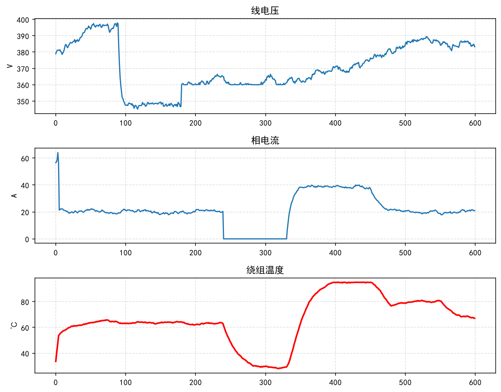
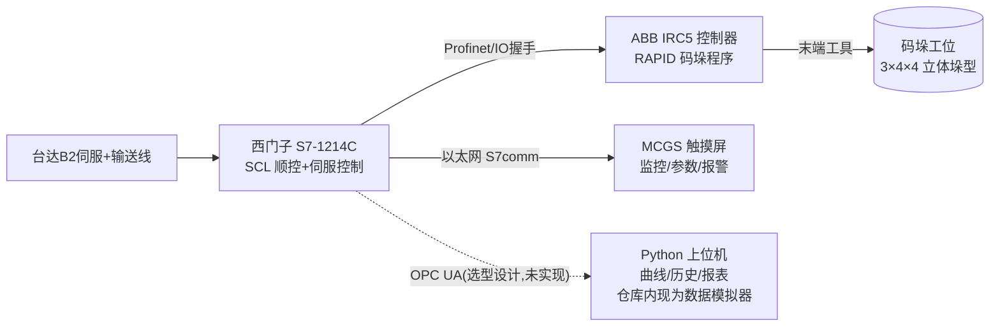

# PLC-Robot-Integration

[](https://github.com/lwj15089590118/PLC-Robot-Integration/actions/workflows/ci.yml)


[](src/PLC_Logic.scl)
[](src/Robot_Program.mod)

> **项目定位（请先读）**：这是我的**个人学习/求职作品集项目**，用于把课堂上学到的 PLC、伺服、工业机器人知识串成一个完整工程。项目在 **TIA PLCSIM + RobotStudio 虚拟环境**中完成联调，仓库内所有"调试数据/性能指标"均为**仿真验证值**，不涉及真实产线交付。硬件清单是选型方案，仓库不含实物。

西门子 PLC 控制 ABB 机器人码垛的仿真工程：PLC 负责产线逻辑（伺服送料、限位保护、模式管理、故障处理），ABB 机器人执行抓取-放置码垛，MCGS 触摸屏做人机界面，Python 上位机脚本完成采集数据仿真、曲线监控与报表统计（OPC UA 采集客户端为选型设计，尚未实现，见第 2 节技术选型）。按真实工程交付物组织：程序、设计文档、接线/选型说明、故障库、调试日志、操作手册齐全。


*上图为 `scripts/数据模拟器.py` 在故障注入场景（`--fault volt_sag,overcurrent,overtemp`）下的真实运行输出：三相电压 / 电流 / 绕组温度（数据为仿真值）。不带 `--fault` 运行即纯正常工况。*

## 1. 系统架构



信号流：光电检测物料 → 伺服送料到位 → PLC 发"启动"给机器人 DI1 → 机器人抓放（夹爪 DO4）→ "码垛完成" DO2 回 PLC → 下一循环；急停/安全门走硬件安全链，同时切断伺服使能与机器人运动。

## 2. 技术选型及理由

| 层级 | 选型 | 理由 |
|---|---|---|
| PLC | 西门子 S7-1214C DC/DC/DC | 晶体管输出支持 4 路高速 PTO 直接发脉冲；SCL 文本化编程便于版本管理；市场保有量大，招聘需求多 |
| 伺服 | 台达 ASDA-B2 750W | 性价比高，脉冲+方向控制简单，调参软件免费，备件易购 |
| 机器人 | ABB IRB1200 + IRC5 | RAPID 语言结构化好（模块/例程/中断），RobotStudio 可离线仿真，教材资料多 |
| 触摸屏 | MCGS TPC7062Ti | 组态门槛低、价格低，支持 S7-1200 以太网驱动 |
| 上位机 | Python + matplotlib（snap7/opcua 采集客户端为选型设计，仓库内现为数据模拟器） | 免费开源，数据处理与可视化生态强，便于扩展云监控 |

## 3. 系统性能指标（仿真验证值）

| 指标 | 设计值 | 仿真验证值 |
|---|---|---|
| 单件码垛节拍 | ≤ 20 s | 18.5 s（RobotStudio 节拍仿真） |
| 伺服定位重复精度 | ±0.5 mm | ±0.2 mm（PLCSIM 脉冲计数法） |
| 机器人 TCP 重复定位 | ±0.05 mm | 出厂参数（未实测） |
| 通讯周期（PLC↔屏） | ≤ 200 ms | ~100 ms |
| 连续运行考核 | 48 h（仿真加速） | 故障停机 0 |
| 启动成功率 | ≥ 99% | 100%（48h 仿真考核 0 失败，过程记录见 `logs/完整调试记录.md` D25~D30） |

## 4. 项目硬件清单（选型方案）

| 设备 | 型号 | 数量 |
|---|---|---|
| PLC | 西门子 S7-1214C DC/DC/DC | 1 |
| 伺服 | 台达 ASDA-B2 750W + ECMA 电机 | 1 套 |
| 机器人 | ABB IRB1200-7/0.9 + IRC5 | 1 套 |
| 触摸屏 | MCGS TPC7062Ti | 1 |
| 传感器 | 欧姆龙 E3Z 光电×2、WL 限位×2 | 4 |
| 夹爪 | SMC 真空吸盘 + 电磁阀 | 1 套 |
| 电气件 | 明纬 S-100-24、正泰断路器/接触器、DSQC652 I/O 板 | 若干 |

详细选型计算（含伺服转矩公式与算例）见 `docs/硬件选型手册.md`，端子级接线见 `docs/硬件接线图说明.md`。以上为**按图纸设计的选型方案**，本项目未采购实物。

## 5. 目录结构

```
PLC-Robot-Integration/
├── README.md
├── LICENSE                        # MIT License
├── requirements.txt               # Python依赖(仅matplotlib, 其余为标准库)
├── src/                           # 主线: 码垛单元源程序
│   ├── PLC_Logic.scl              # 伺服FB+顺控FB+故障FB (TIA外部源)
│   ├── Robot_Program.mod          # RAPID: 标定/轨迹/安全逻辑
│   └── HMI_Screenshots/画面说明.md # MCGS三画面草图(截图待补)
├── docs/                          # 工程文档
│   ├── 系统设计说明书.md           # 需求→架构→方案→调试→自验判据
│   ├── 硬件选型手册.md             # PLC对比/伺服公式/传感器原则
│   ├── 硬件接线图说明.md           # 端子号/线径/屏蔽接地
│   ├── 程序流程图.md               # 初始化→手动→自动→故障
│   ├── 仿真测试用例.md             # 24组互锁真值表+故障注入用例
│   ├── 调试笔记.md                 # 10条避坑
│   ├── 数据示例.csv                # 模拟器真实运行输出(故障注入场景)
│   ├── 报表示例.txt                # 模拟器真实运行输出(故障注入场景)
│   └── images/监控曲线示例.png     # 模拟器真实运行输出(故障注入场景)
├── fault_cases/                   # 故障库
│   ├── 故障大全.md                 # 50条 现象-原因-处理-预防
│   └── 故障排查手册.md             # 30条 现象-原因-处理
├── scripts/                       # Python上位机脚本
│   ├── 数据模拟器.py               # 完整版: 曲线+历史CSV+报表+故障注入
│   ├── 模拟数据生成器.py           # 轻量版: 纯标准库, 仅CSV
│   └── 真值表复算.py               # 复算仿真测试用例表1/表2与SCL逻辑是否一致
├── manual/操作说明书.md            # 按真实产线规范编写的操作手册
├── logs/完整调试记录.md            # 30天分阶段虚拟调试记录
├── resume/                        # 求职素材(自述与简历描述)
└── star_delta_demo/               # 早期实训练习: 星三角启动柜(2026-06)
    ├── PLC/star_delta.scl
    ├── PLC/hmi_tag.csv
    ├── 电气图纸/主回路接线图.txt     # 文本模拟图(占位.dwg)
    ├── 电气图纸/I_O分配表.md        # 文本模拟表(占位.xlsx)
    ├── 操作说明书.md
    └── 现场调试记录.txt             # 实训台调试记录
```

> 说明：`star_delta_demo` 下 `.dwg`/`.xlsx` 为纯文本模拟占位文件；接线图图号（E-XD-01/02）在 `docs/硬件接线图说明.md` 中以文字版给出。

## 6. 快速开始

1. **PLC**：TIA Portal →“外部源文件”导入 `src/PLC_Logic.scl` → 右键“从源生成块”→ 编译下载（PLCSIM 即可）。
2. **机器人**：RobotStudio 加载 `src/Robot_Program.mod`，先 v100 低速空跑验证路径。
3. **上位机**：`pip install -r requirements.txt`（实际仅需 matplotlib；未安装时脚本自动降级为仅生成 CSV）后运行
   `python scripts/数据模拟器.py --samples 600 --fault volt_sag,overcurrent,overtemp --save-fig docs/images/监控曲线示例.png --report --output docs/数据示例.csv`
   `docs/` 下的曲线图、CSV、报表就是这条命令（故障注入场景）的运行产物；不带 `--fault` 运行即纯正常工况（报表故障/预警为 0）。
4. **测试用例**：对照 `docs/仿真测试用例.md` 在 PLCSIM 中逐条注入验证；表1/表2 期望值可先用
   `python scripts/真值表复算.py` 自动复核（与 `src/PLC_Logic.scl` 逻辑逐行对照，不一致时非零退出）。

## 7. 常见问题（面试官/HR 可能会问）

- **Q：这是真实产线项目吗？** 不是。个人学习项目，全流程在 PLCSIM + RobotStudio 虚拟环境完成，README 所有指标均标注为仿真验证值；我能在面试中现场演示并解释每个数字的来源。
- **Q：为什么没有实物照片？** 项目无实物，硬件清单是按图纸做的选型方案；HMI 画面为设计草图，截图位置已预留。
- **Q：你在项目中的角色？** 独立完成：SCL 程序、RAPID 改造、MCGS 画面设计、Python 脚本、全部文档；详见 `resume/项目成果总结.md`。
- **Q：数据可信吗？** `docs/数据示例.csv`、`报表示例.txt`、`images/监控曲线示例.png` 由仓库内脚本真实运行生成，可复现。
- **Q：后续计划？** 见第 9 节扩展方向；同时计划考取低压电工证并寻找实习，把虚拟调试经验落到真实设备。

## 8. 扩展示例：星三角启动控制柜

`star_delta_demo/` 是更早（2026-06）的实训练习（MCC-01 电机启动柜），演示同类交付物在“单台设备”场景下的完整组织：SCL 功能块（星三角切换死区、过载锁存、急停复位）、MCGS 变量表、主回路文本图与 I/O 分配、操作手册与调试记录。与主线码垛单元互相独立。

## 9. 未来扩展方向

视觉引导抓取（海康相机 + OpenCV 定位补偿）、MQTT 云端看板（EMQX + Grafana）、RobotStudio 数字孪生联调、AGV 自动换托盘、MES 报工对接、安全 PLC 升级（双通道急停 + 速度监控）。

## 10. 作者

电气自动化专业（大专）。邮箱/微信：2156791374@qq.com/LWJ2156791374
