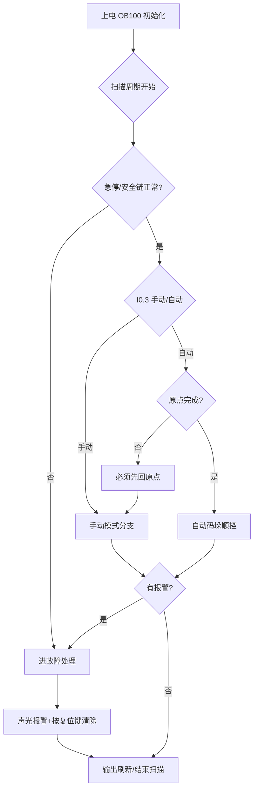

# 程序流程说明

主程序为 OB1 循环扫描，配合上电初始化(OB100)与循环中断(周期 10ms 的伺服脉冲控制)。整体按“初始化 → 模式判断 → 手动/自动分支 → 故障处理”组织。

## 1. 初始化(OB100)
1. 所有输出清零，置“待机”状态，黄灯亮。
2. 调用 FB_ServoCtrl 实例复位，伺服使能先不闭合。
3. 置位初始化标志 M0.0，等待模式选择。

## 2. 模式判断(每周期)
1. 读 I0.3，进入手动或自动分支，模式切换时先停伺服输出再切换，防止飞车。
2. 任何时刻急停 I1.0 断开，立即跳故障处理。

## 3. 手动模式
1. 允许操作：伺服点动正/反(受两限位互锁，复用 FB_ServoCtrl 逻辑)、伺服使能 ON/OFF、手动回原点。
2. 点动速度限定低速(如 20kHz 脉冲)，按住走、松开停。
3. 手动模式下不给机器人发启动命令(Q0.7 强制为 0)。
4. 回原点：压正向限位后退回偏移量，置“原点完成”M1.0。

## 4. 自动模式(前置条件：原点完成=1 且无报警)
1. 按启动(I0.0 上升沿)→ 伺服使能、输送线运行，绿灯亮。
2. 光电 I0.7 检测到物料 → 伺服按设定脉冲数送料到位后停。
3. 等机器人 DO1(允许抓取)=1 → PLC 置位 Q0.7 发“码垛启动”脉冲(≥500ms)。
4. 等机器人 DO2(码垛完成)=1 → 夹爪已由机器人 DO4 自行控制，PLC 继续下一件送料。
5. 计数器累计层数/列数，满垛后置“换垛”标志，暂停送料并提示人工换托盘，按启动继续。
6. 按停止(I0.1)→ 完成本循环后受控停止，回到待机。

## 5. 故障处理(最高优先级)
1. 触发源：急停断开、安全门开、伺服 ALM(I1.4 断开)、机器人故障(I1.3)、双限位同时导通。
2. 动作：切断伺服使能、脉冲输出立即失效(PTO 停止)、Q0.7 复位、红灯+蜂鸣器、HMI 弹报警窗。
3. 复位条件：故障源消失后按复位按钮(I0.2)才清除锁存；急停需旋起复位后再按复位键。
4. 复位后不直接恢复自动运行，须重新按启动，防止意外重启。
